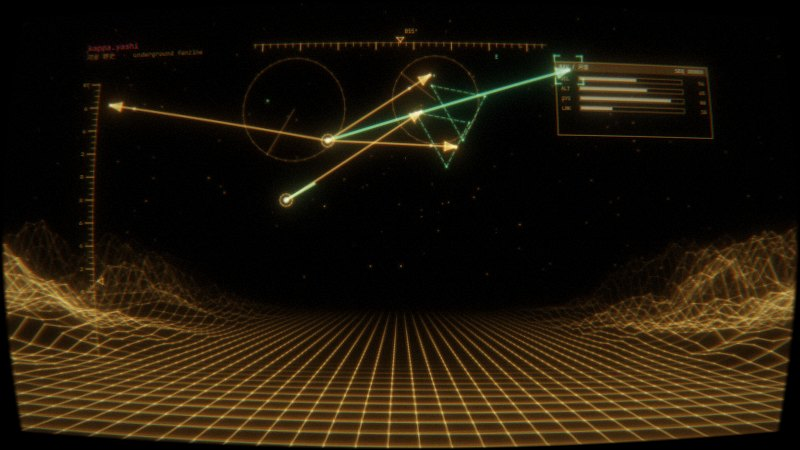
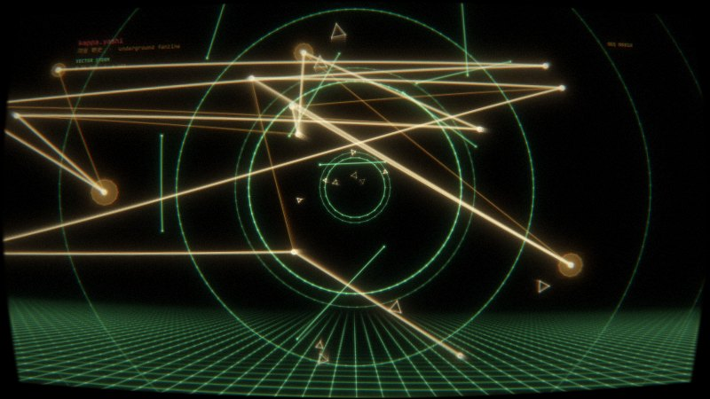
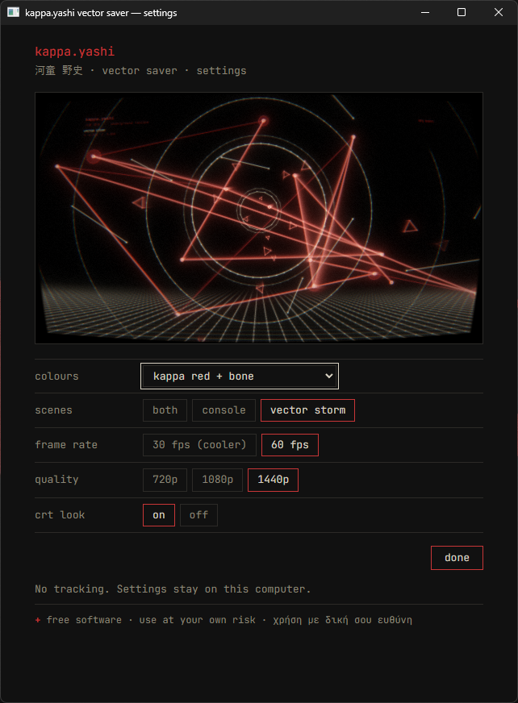
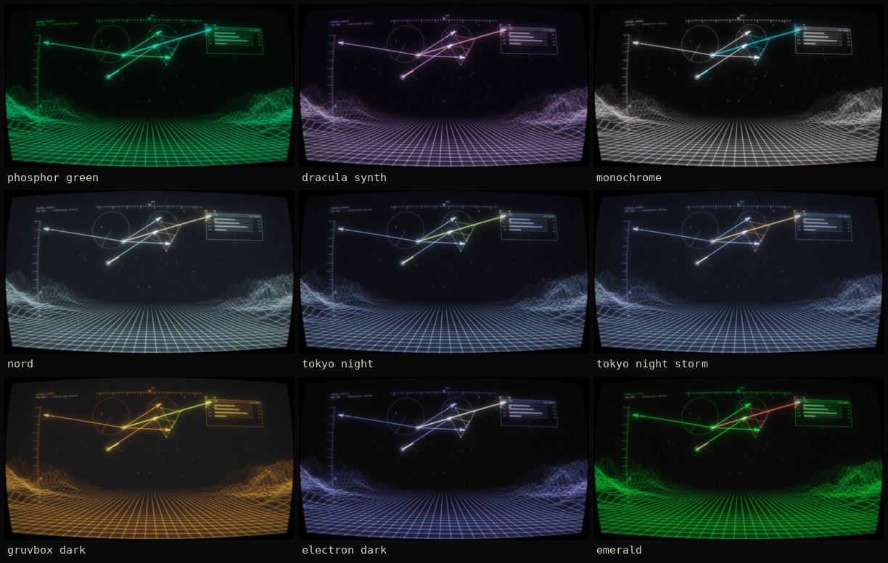

# kappa.yashi — vector saver

Repo: https://github.com/kappa-yashi/idle-vector_scrnsvr

<p> </p>


A generative screensaver in the look of the kappa.yashi vector-console clips: amber wireframe terrain, arrows, wire cubes, radar rings, a CRT monitor. It never loops, runs at any resolution, and needs nothing from the internet.

> **Disclaimer — free software, use at your own risk.** This is a free personal project, provided "as is" with no warranty of any kind. kappa.yashi and its author(s) accept no responsibility or liability, to the fullest extent the law allows, for anything that results from downloading, installing or using it (data loss, hardware or driver problems, overheating, power use, screen burn-in …). It is **not a security tool** and does not lock your computer. It contains **flickering and flashing effects** — don't use it if you are sensitive to those, or switch "crt look" off. Full text in English and Greek: [DISCLAIMER.md](DISCLAIMER.md). / *Δωρεάν λογισμικό, χρήση με δική σου ευθύνη — δες το DISCLAIMER.md.*

- `index.html` — the whole scene (WebGL2, one file, JetBrains Mono embedded). Open it in a browser to preview: `F` fullscreen, `M` next scene, `P` next colour set, `C` CRT on/off, `Space` pause.
- `settings.html` — the settings window (colours, scenes, frame rate, quality, CRT look) with a live preview.
- `host/` — the tiny native app (Rust: `tao` + `wry`) that turns the page into a real screensaver. It opens one borderless window per monitor, any key / click / real mouse movement quits, and it stores your settings in `settings.json` next to the WebView profile (`%LOCALAPPDATA%\kappayashi-saver` on Windows, `~/.local/share/kappayashi-saver` on Linux).
- `.github/workflows/build.yml` — the GitHub Actions workflow that builds the Windows `.scr` and the Linux binary on GitHub's servers.

## Download

Ready-made builds are on the [Releases](https://github.com/kappa-yashi/idle-vector_scrnsvr/releases) page: `kappayashi-saver-windows-x64.zip` and `kappayashi-saver-linux-x86_64.tar.gz`. Nothing to compile.

## Build it yourself

You don't need Rust on your PC.

1. Fork or copy this repo (it already contains the workflow).
2. Make sure Actions are enabled in the repo.
3. Open the **Actions** tab → **build** → **Run workflow** (Windows only by default; tick *linux* to add the Linux build). It takes ~5 minutes. The workflow never runs on its own when you commit, only when you press the button or push a `v*` tag.
4. Open the finished run → **Artifacts** → download `kappayashi-saver-windows` → it contains `kappa.yashi.scr` and `kappayashi-saver.exe`.

To publish: **Run workflow** with the *release* field filled in (e.g. `v0.1.0`; a dash like `v0.1.0-beta.1` makes it a pre-release), or push a tag like `v0.1.0`. Either builds both and creates a Release with the Windows and Linux files attached.

**Free-plan note.** Keep this in its own repo, separate from the website repo. Private repos on the free plan get a monthly allowance of Actions minutes (2,000 at the time of writing; Windows minutes count about double), a public repo gets standard runners for free. One Windows-only run is roughly 10 billed minutes. A Cloudflare Pages site is built by Cloudflare, not by GitHub Actions, so its deploys don't touch that allowance.

## Install on Windows

- Right-click `kappa.yashi.scr` → **Install**. Windows copies it and opens *Screen Saver Settings*; pick **kappa.yashi** and set the wait time.
- **Settings…** opens our settings window (below: Windows 11). **Preview** shows the real thing fullscreen. (The small thumbnail in that dialog stays black — we don't draw into it.)

  

- The file isn't code-signed, so SmartScreen may warn the first time: **More info → Run anyway**.
- It needs the WebView2 runtime, which Windows 11 and up-to-date Windows 10 already have.

To test without installing: `kappa.yashi.scr /s` from a terminal (fullscreen), `kappa.yashi.scr /c` (settings), or `kappayashi-saver.exe --saver --windowed`.

## Linux

Get `kappayashi-saver-linux-x86_64.tar.gz` from Releases (`kappayashi-saver` + `kappayashi-idle.sh`; if the exec bit got lost, `chmod +x` both). It needs WebKitGTK 4.1 (`libwebkit2gtk-4.1-0` on Mint 22 / Ubuntu 24.04, `webkit2gtk-4.1` on Arch).

```
kappayashi-saver --saver              # run it now (one window per monitor)
kappayashi-saver --saver --windowed   # in a normal window, for testing
kappayashi-saver --config             # settings window
```

Linux has no common screensaver API, so something has to start it when you go idle:

- X11 (Mint / Cinnamon): `kappayashi-idle.sh 5` starts it after 5 idle minutes (needs `xprintidle`). Cinnamon's own lock screen may kick in first — raise its delay.
- Wayland (Hyprland): in `~/.config/hypr/hypridle.conf`
  ```
  listener {
      timeout = 300
      on-timeout = /path/to/kappayashi-saver --saver
  }
  ```
  If your setup already has its own screensaver (Omarchy does), disable that one so they don't fight.

## Status

- Also verified: the page renders both scenes (software GL screenshots); the host builds and runs on Linux under a virtual X server — page loads over the custom protocol, settings save and are picked up by the saver, a key press or real mouse movement quits, a tiny mouse jitter does not.
- Verified on Windows 11: install, settings window, fullscreen saver, exit on input. Not verified yet: Windows 10, real Linux desktops (X11 and Wayland), multi-monitor.
- macOS isn't covered: a real `.saver` with a WebView is unreliable on recent macOS — see the project notes.

## Colours

`amber` (default, like the original clips) and `kappa` (brand red + bone), plus the dark themes of [kappayashi.page](https://kappayashi.page): Phosphor Green, Dracula Synth, Monochrome, Nord, Tokyo Night, Tokyo Night Storm, Gruvbox Dark, Electron Dark, Emerald. Pick one in the settings window.



Theme credits: Nord, Tokyo Night and Gruvbox are MIT-licensed colour schemes by their authors; Phosphor Green, Dracula Synth and Monochrome come from the Retro TUI Portfolio template (MIT, © Nivin).

## Page options (URL parameters)

`?palette=amber|kappa|green|dracula|mono|nord|tokyo-night|tokyo-storm|gruvbox-dark|electron-dark|emerald` · `?scene=both|nav|storm` · `?fps=30|60` · `?h=720|1080|1440` (internal render height) · `?crt=0` · `?seed=N`. They override the saved settings; `?saver=1` and `?embed=1` are used by the host and the settings preview.

## Licence

[PolyForm Noncommercial 1.0.0](LICENSE.md). In short (the licence text is what counts):

- Free for any **noncommercial** use: personal, hobby, study, non-profits, schools.
- You may **change** it and **share** it, changed or not, also for free only.
- **No commercial use** of any kind: no selling it, no bundling it into something paid, no use in paid client work.
- Whoever shares it must pass on the licence and keep the credits — the two `Required Notice:` lines at the top of [LICENSE.md](LICENSE.md):
  `kappa.yashi - https://www.kappayashi.page/` and `https://github.com/kappa-yashi/idle-vector_scrnsvr/`

For commercial use, ask via https://www.kappayashi.page/.

Third-party parts keep their own licences: the JetBrains Mono font embedded in the pages (SIL OFL 1.1), the Rust crates in the native host (`tao`, `wry` and their dependencies, MIT/Apache-2.0), and the Nord, Tokyo Night, Gruvbox and Retro TUI colour schemes (MIT). See also [DISCLAIMER.md](DISCLAIMER.md).
